<p align="center">
  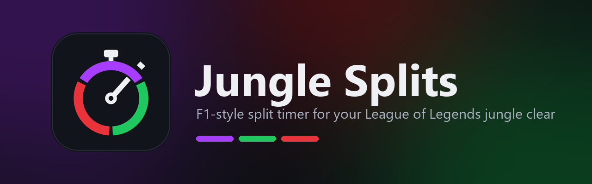
</p>

<p align="center">
  <a href="https://github.com/Thiscesarr/jungle-splits/releases/latest/download/JungleSplits-Setup.exe"></a>
</p>

<p align="center">
  <a href="https://github.com/Thiscesarr/jungle-splits/releases/latest"></a>
  <a href="https://github.com/Thiscesarr/jungle-splits/releases"></a>
  
  <a href="LICENSE"></a>
</p>

<p align="center">
  <a href="#english"> English</a> &nbsp;·&nbsp; <a href="#português"> Português</a>
</p>

---

##  English

**Jungle Splits** is an F1-style split timer for jungle full clears in the League of Legends **Practice Tool**.
It sits on top of the game and tells you, camp by camp, where you gained and where you lost time against your
best run, so you know whether an attempt is worth finishing before you even get to the last camp.

<p align="center">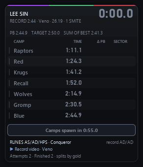</p>

### ✨ Features

| | |
|---|---|
| 🏁 **F1 sector colors** | 🟣 your best ever on that camp · 🟢 faster than your PB · 🔴 slower than your PB |
| ⏱️ **Live delta** | Overall gain or loss against your PB, right under the clock, updated while you clear |
| 🧭 **Should I reset?** | A verdict that turns to `RESET` as soon as the run can no longer beat your PB |
| 🤖 **Hands-free** | Camps close on their own, the route is recognized on its own, Practice Tool resets start a new attempt |
| 🌎 **Every champion** | Routes and records from the community [Jungle Clear Compilation](https://docs.google.com/spreadsheets/d/1jE8bnlnIJnmWv9pnVW9veMKRXJNaaJf5tneQB3xUkbI), updated automatically |
| ▶️ **Record video** | A link to the YouTube video of the record for the route you are running |
| 🔢 **1 or 2 smites** | Separate PBs and records, remembered per champion |
| 🧪 **Rune shards** | Your shards (e.g. `AS/AD/HPS`) next to the ones the record used |
| 🔔 **Sound alerts** | Spawn countdown, sector colors, reset warning and new PB, for when your eyes are on the clear |
| ⌨️ **60% keyboard friendly** | Rebindable hotkeys, no F-keys needed |

### 📥 Install

1. **[Download the installer](https://github.com/Thiscesarr/jungle-splits/releases/latest/download/JungleSplits-Setup.exe)**
   (or the [portable zip](https://github.com/Thiscesarr/jungle-splits/releases/latest/download/JungleSplits-Portable.zip), no installation).
2. Run it and pick your language. It installs just for your user: no administrator prompt.
3. Set League of Legends to **Borderless** window mode (overlays can't draw over exclusive fullscreen).
4. Open the **Practice Tool** with any champion and start clearing.

> [!NOTE]
> **"Windows protected your PC"?** Windows SmartScreen shows this for new apps that haven't been downloaded
> many times yet. It is not a virus warning. Click **More info → Run anyway**. Every release is built
> automatically on GitHub from this public source code, and its SHA-256 checksums are published next to the
> download (`SHA256SUMS.txt`).

### 🎮 How to use

<table>
  <tr>
    <td width="50%">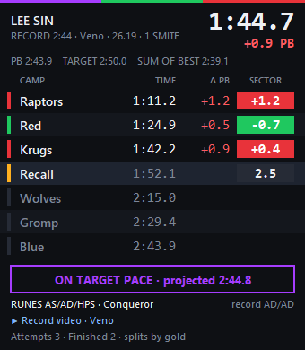</td>
    <td width="50%">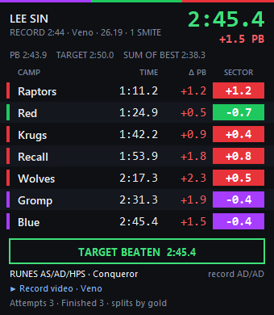</td>
  </tr>
</table>

- **Clock**: game time of the current attempt. Camps spawn at **0:55**.
- **TIME / Δ PB / SECTOR**: the time each camp finished, the overall difference to your PB at that point, and how
  much that camp alone gained or lost (colored like F1 sectors).
- **Verdict**: `AHEAD OF PB`, `BEHIND PB · still possible`, `ON TARGET PACE` (your target, e.g. 2:50) or
  `RESET · can't beat the PB`.
- **New attempt**: use **Reset Game** in the Practice Tool. The game clock keeps running after a reset, so the
  overlay notices it (level back to 1, empty inventory, starting gold) and starts its own clock from 0:00.
- **Wrong route?** Clear the way you want: the overlay recognizes the route from the camps' signature and
  switches, keeping your times.

| Default hotkey | Action |
|---|---|
| `Ctrl` `Shift` `,` | Settings |
| `Ctrl` `Shift` `.` | Move overlay (shows a ✕ to close the app) |
| `Ctrl` `Shift` `]` | New run (restart the clock now) |
| `Ctrl` `Shift` `=` | Toggle 1 / 2 smites |
| `Ctrl` `Shift` `-` | Sound on/off |

Keys are shown as on a US layout; they are the same physical keys on any layout. Everything is also in the
**tray icon** next to the Windows clock.

### ⚙️ Settings

<table>
  <tr>
    <td>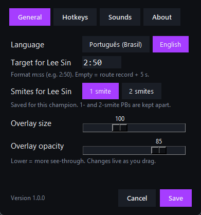</td>
    <td>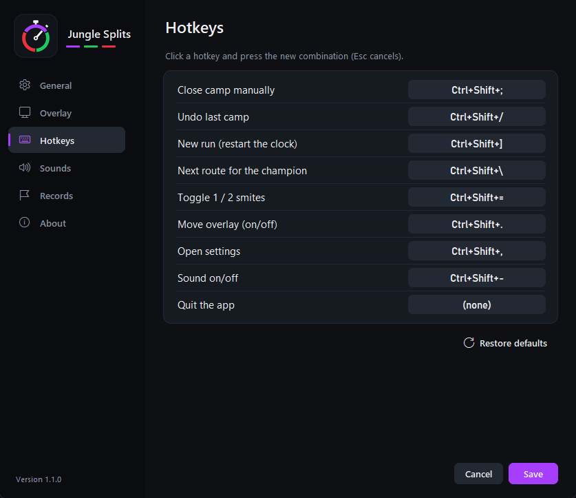</td>
    <td>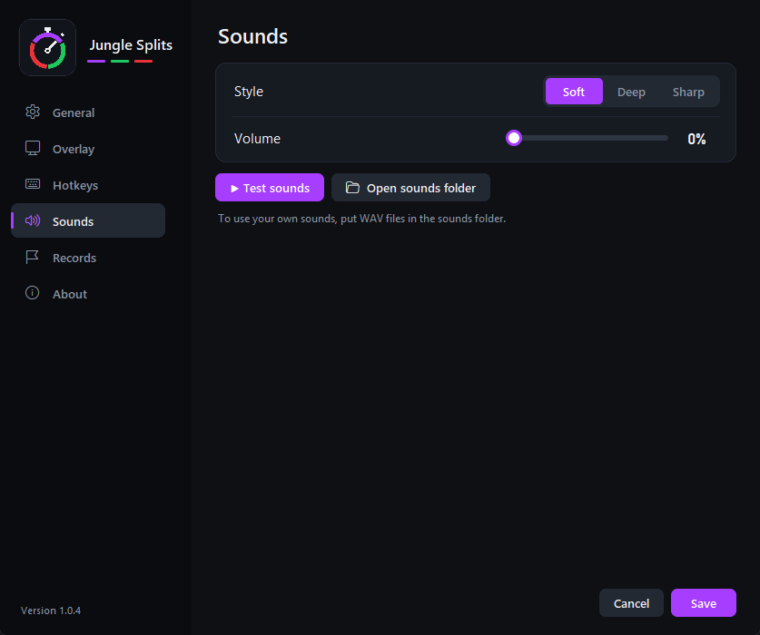</td>
  </tr>
</table>

Language, your **target time per champion**, smites, overlay size and opacity, hotkeys (click and press the new combination)
and sounds (style, volume, preview, or your own `.wav` files).

### ❓ FAQ

<details>
<summary><b>Is it safe for my account? Does it work with Vanguard?</b></summary>

Jungle Splits only reads Riot's official **Live Client Data API**, the same local API that tools like Porofessor
and Blitz use. It does not read or change game memory, does not automate any input and only gives feedback in the
Practice Tool, where nothing is at stake.
</details>

<details>
<summary><b>How does it know when a camp is done?</b></summary>

From the gold monsters pay out (the API doesn't report which camp died). After your first full clear it learns
each camp's exact gold and closes the camp the instant it is cleared.
</details>

<details>
<summary><b>Can it count how many smites I used?</b></summary>

No: the game's API doesn't expose summoner spell casts. Pick 1 or 2 smites once per champion and it is remembered.
</details>

<details>
<summary><b>Where is my data?</b></summary>

`%LOCALAPPDATA%\Jungle Splits`: PBs per champion, route and smite count, your settings and custom sounds.
</details>

---

##  Português

O **Jungle Splits** é um cronômetro estilo F1 para full clear de jungle no **Practice Tool** do League of Legends.
Ele fica por cima do jogo e mostra, campo a campo, onde você ganhou e onde perdeu tempo em relação à sua melhor
run. Assim você sabe se a tentativa vale a pena antes mesmo de chegar ao último campo.

<p align="center">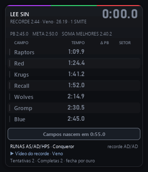</p>

### ✨ Recursos

| | |
|---|---|
| 🏁 **Cores de setor da F1** | 🟣 seu melhor tempo naquele campo · 🟢 mais rápido que o PB · 🔴 mais lento que o PB |
| ⏱️ **Diferença ao vivo** | Quanto você está ganhando ou perdendo para o PB, embaixo do relógio, durante o clear |
| 🧭 **Vale resetar?** | Um veredito que vira `RESET` assim que a run não consegue mais bater o seu PB |
| 🤖 **Sem apertar nada** | Os campos fecham sozinhos, a rota é reconhecida sozinha, o Reset do Practice Tool começa outra tentativa |
| 🌎 **Todos os campeões** | Rotas e recordes da planilha da comunidade [Jungle Clear Compilation](https://docs.google.com/spreadsheets/d/1jE8bnlnIJnmWv9pnVW9veMKRXJNaaJf5tneQB3xUkbI), atualizada sozinha |
| ▶️ **Vídeo do recorde** | Link para o vídeo no YouTube do recorde da rota que você está fazendo |
| 🔢 **1 ou 2 smites** | PBs e recordes separados, lembrados por campeão |
| 🧪 **Fragmentos de runa** | Seus fragmentos (ex.: `AS/AD/HPS`) ao lado dos usados no recorde |
| 🔔 **Avisos sonoros** | Contagem para os campos nascerem, cor de cada setor, aviso de reset e novo PB |
| ⌨️ **Feito para teclado 60%** | Atalhos configuráveis, sem precisar das teclas F |

### 📥 Instalação

1. **[Baixe o instalador](https://github.com/Thiscesarr/jungle-splits/releases/latest/download/JungleSplits-Setup.exe)**
   (ou o [zip portátil](https://github.com/Thiscesarr/jungle-splits/releases/latest/download/JungleSplits-Portable.zip), sem instalação).
2. Execute e escolha o idioma. Ele instala só para o seu usuário: não pede permissão de administrador.
3. Deixe o League of Legends em modo **Sem bordas** (overlays não aparecem em tela cheia exclusiva).
4. Abra o **Practice Tool** com qualquer campeão e comece o clear.

> [!NOTE]
> **"O Windows protegeu o computador"?** O SmartScreen do Windows mostra esse aviso para apps novos que ainda não
> foram baixados muitas vezes. Não é um aviso de vírus. Clique em **Mais informações → Executar assim mesmo**.
> Toda versão é gerada automaticamente no GitHub a partir deste código público, e os checksums SHA-256 ficam
> publicados junto do download (`SHA256SUMS.txt`).

### 🎮 Como usar

<table>
  <tr>
    <td width="50%">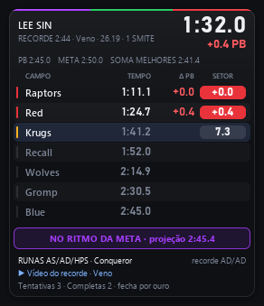</td>
    <td width="50%">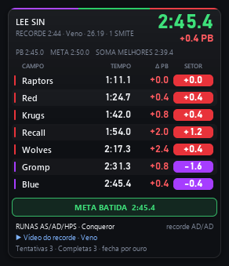</td>
  </tr>
</table>

- **Relógio**: tempo de jogo da tentativa atual. Os campos nascem aos **0:55**.
- **TEMPO / Δ PB / SETOR**: quando cada campo terminou, a diferença total para o PB naquele ponto e quanto aquele
  campo sozinho ganhou ou perdeu (com as cores de setor da F1).
- **Veredito**: `À FRENTE DO PB`, `ATRÁS DO PB · ainda dá`, `NO RITMO DA META` (a sua meta, ex.: 2:50) ou
  `RESET · não bate o PB`.
- **Nova tentativa**: use **Reset Game** no Practice Tool. O relógio do jogo continua correndo depois do reset,
  então o overlay percebe o reset (nível volta a 1, inventário vazio, ouro inicial) e começa o próprio relógio do 0:00.
- **Mudou de rota?** Faça o clear do jeito que quiser: o overlay reconhece a rota pela assinatura dos campos e
  troca, mantendo os seus tempos.

| Atalho padrão | Ação |
|---|---|
| `Ctrl` `Shift` `,` | Configurações |
| `Ctrl` `Shift` `.` | Mover o overlay (mostra um ✕ para fechar o app) |
| `Ctrl` `Shift` `[` | Nova run (zera o relógio agora) |
| `Ctrl` `Shift` `=` | Alternar 1 / 2 smites |
| `Ctrl` `Shift` `-` | Liga/desliga os sons |

As teclas acima são as de um teclado ABNT2 (no `=`, é a tecla `=` / `+`). Tudo também fica no **ícone da
bandeja**, perto do relógio do Windows.

### ⚙️ Configurações

<table>
  <tr>
    <td>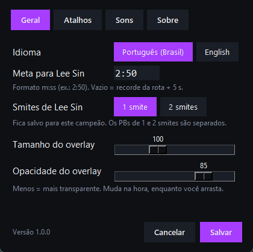</td>
    <td>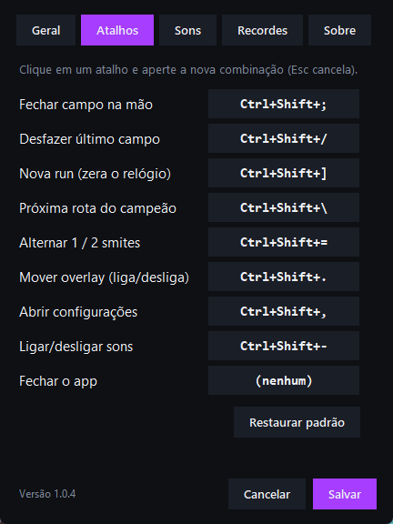</td>
    <td>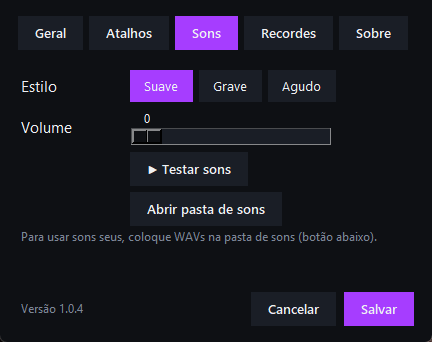</td>
  </tr>
</table>

Idioma, a sua **meta de tempo por campeão**, smites, tamanho e opacidade do overlay, atalhos (clique e aperte a nova combinação)
e sons (estilo, volume, teste, ou seus próprios arquivos `.wav`).

### ❓ Perguntas frequentes

<details>
<summary><b>É seguro para a minha conta? Funciona com o Vanguard?</b></summary>

O Jungle Splits só lê a **Live Client Data API** oficial da Riot, a mesma API local usada por apps como Porofessor e
Blitz. Ele não lê nem altera a memória do jogo, não automatiza nenhuma tecla e só dá feedback no Practice Tool, onde
nada está em jogo.
</details>

<details>
<summary><b>Como ele sabe que um campo terminou?</b></summary>

Pelo ouro que os monstros dão (a API não informa qual campo morreu). Depois do seu primeiro full clear ele aprende o
ouro exato de cada campo e fecha o campo no instante em que ele termina.
</details>

<details>
<summary><b>Ele conta quantos smites eu usei?</b></summary>

Não: a API do jogo não informa o uso de feitiços de invocador. Escolha 1 ou 2 smites uma vez por campeão e ele lembra.
</details>

<details>
<summary><b>Onde ficam os meus dados?</b></summary>

Em `%LOCALAPPDATA%\Jungle Splits`: PBs por campeão, rota e quantidade de smites, as suas configurações e os sons
personalizados.
</details>

---

## 🛠️ Development

```bash
pip install -r requirements-build.txt
python main.py --demo --demo-speed 3 --demo-random-route   # try it without the game
python -m unittest discover -s tests                         # tests
python tools/make_assets.py                                  # icon and banner
python tools/capture_media.py                                # README screenshots and GIFs
python tools/build.py                                        # dist/: app, portable zip, installer (needs Inno Setup)
```

**Releasing:** bump `version.py`, then push a tag (`git tag v1.0.1 && git push origin v1.0.1`). The
[Release workflow](.github/workflows/release.yml) runs the tests, builds the app and the installer on GitHub and
publishes them. Download counts show on the badge above and in each release.

## 📄 License

[MIT](LICENSE): free to use, modify and share, keeping the copyright notice.

## 🙏 Credits

- Routes, records, videos and rune notes: the community **Jungle Clear Compilation** sheet and the players who
  recorded those clears.
- Game data: Riot Games' [Live Client Data API](https://developer.riotgames.com/docs/lol#game-client-api).

<sub>Jungle Splits isn't endorsed by Riot Games and doesn't reflect the views or opinions of Riot Games or anyone
officially involved in producing or managing Riot Games properties. Riot Games, and all associated properties are
trademarks or registered trademarks of Riot Games, Inc.</sub>
